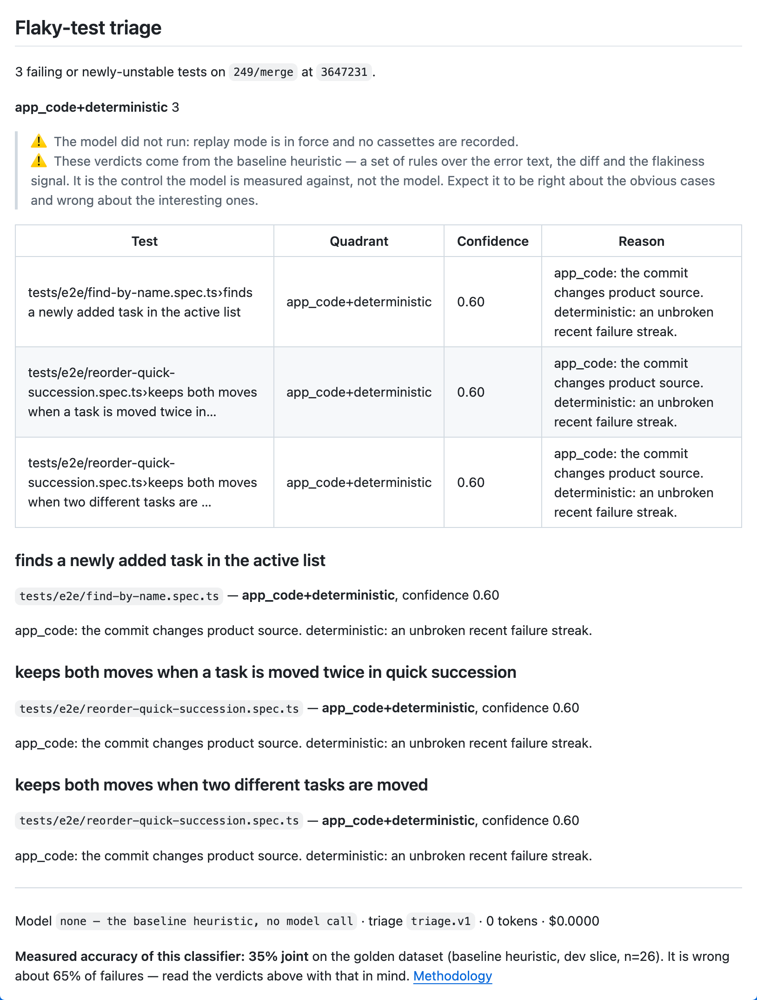
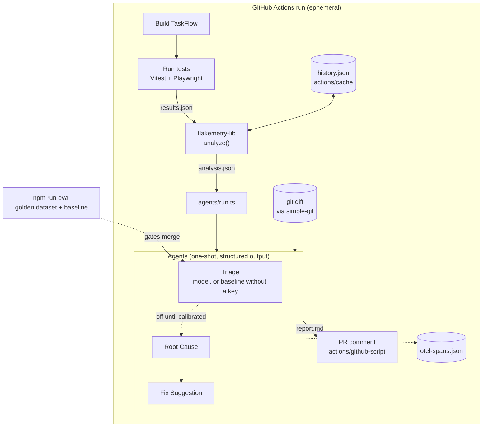

# Sentra

**An AI triage layer for CI test failures — packaged as a pipeline step, not a service.**

[](https://github.com/AKogut/ai-flaky-test-triage/actions/workflows/ci.yml)
[](https://github.com/AKogut/ai-flaky-test-triage/actions/workflows/codeql.yml)
[](https://scorecard.dev/viewer/?uri=github.com/AKogut/ai-flaky-test-triage)
[](https://github.com/AKogut/ai-flaky-test-triage/issues)
[](LICENSE)
[](package.json)

<!-- status:start -->

> **Project status: M3 — Triage agent & replay mode.**
> 5 of 11 milestones complete.
> Current exit criterion: the triage agent beats the baseline on joint accuracy by a margin that survives its confidence interval — or the finding that it does not is documented in the README. Either way, `npm run demo` runs the classifier end to end with no API key.
>
> Progress is tracked as [milestones](https://github.com/AKogut/ai-flaky-test-triage/milestones), not dates.
> Commands marked 🚧 in the script table are not implemented yet and say so when run.

<!-- status:end -->

---

## The problem

Flaky-test detectors tell you _which_ tests are unstable. They do not tell you _what to do
about it_. After every red CI run somebody still has to open the trace, read the stack, look
at the diff, and decide: is this a real bug, a badly written test, or the runner having a bad
day? That decision is repetitive, requires context from several places at once, and is exactly
the kind of work that gets skipped under deadline pressure — which is how a real regression
ends up rerun-until-green.

Sentra automates the **decision layer**, not the detection layer. It runs once, right after
the test step, reads what already exists in the CI checkout (test report, run history, git
diff), classifies every failure, and writes a single markdown report that gets posted as one PR
comment. Agents that hypothesise a root cause and suggest a fix are built too, and stay switched
off until the classifier's confidence is calibrated well enough to say which failures deserve one.

## What this is

- A **single repository** that contains a small app, a test suite with genuine flakiness, and
  the AI pipeline that analyses the results.
- A **one-shot CLI pipeline**. Every part is `npm run <script>`. Nothing stays running.
- An **evaluated** system: the classifier is measured against a hand-labelled golden dataset,
  compared against a non-LLM baseline, and gated in CI. Today only the baseline has a number —
  see [Evaluation, honestly](#evaluation-honestly).
- **Reproducible without credentials**: anyone can clone the repo and run the whole pipeline end
  to end with no API key. A recorded-response replay mode is built for the model calls; until
  responses are recorded, the credential-free run uses the baseline and says so.

## What this is not

- Not a service. No server, no queue, no webhook listener, no database to host.
- Not a GitHub App. PR comments are posted by a normal workflow step using the built-in
  `GITHUB_TOKEN`.
- Not an auto-fixer. Agents never write to the working tree, never push, never open PRs.
  Fix suggestions are text in a report that a human reads and decides on.
- Not a Flakemetry replacement. Flakemetry-style analysis is consumed here as a library; this
  project is the layer above it.

---

## What it posts today

<picture>
  <source media="(prefers-color-scheme: dark)" srcset="docs/assets/pr-comment-dark.png">
  
</picture>

A real comment, posted by this repository's own CI on
[#255](https://github.com/AKogut/ai-flaky-test-triage/pull/255#issuecomment-7101432030) and not
retouched. The verdicts come from the **baseline heuristic**, because no model has been scored yet,
and the comment says so twice.

It is also a fair picture of why the baseline is the bar rather than the product. It gets one of
the three right: the reorder race really is `app_code` + `intermittent`. The other two are test
bugs. The pull request touched `agents/`, so the baseline blamed them on the change, and it called
`find-by-name` deterministic as well. Telling the race in the product from the race in the test is
the job the model is measured on.

| Classifier                      | Joint accuracy, dev slice (n = 26) | Hard quadrant, `app_code` + `intermittent` (n = 8) |
| ------------------------------- | ---------------------------------: | -------------------------------------------------: |
| Baseline heuristic              |                  34.6% [19.4–53.8] |                                   25.0% [7.1–59.1] |
| Triage agent, `claude-opus-5-5` |        not scored yet — [#38][i38] |                                                  — |

95% Wilson intervals, from [`eval/report.md`](eval/report.md). The agent row stays empty until a run
with an API key fills it, and when it does, the number goes here whichever way it points.

[i38]: https://github.com/AKogut/ai-flaky-test-triage/issues/38

---

## Architecture



Every box lives and dies inside one CI job or one terminal command. There is deliberately no
box that stays on.

Full detail: [`docs/architecture.md`](docs/architecture.md).

---

## Classification taxonomy

A single flat label list (`real_bug | flaky_infra | stale_test | race_condition`) collapses under its own
weight — a race condition in application code _is_ a real bug, so the labels overlap and the
ground truth stops being reproducible. Sentra classifies on **two orthogonal axes** instead:

|                   | `deterministic`                                             | `intermittent`                                                                   |
| ----------------- | ----------------------------------------------------------- | -------------------------------------------------------------------------------- |
| **`app_code`**    | Genuine regression. Fails every run.                        | Race / ordering bug in the product. Fails sometimes. **The dangerous quadrant.** |
| **`test_code`**   | Stale test — selector or assertion drifted from the app.    | Badly synchronised test — missing wait, shared state, ordering assumption.       |
| **`environment`** | Broken setup — missing dep, bad config, wrong Node version. | Infrastructure noise — runner timeout, port collision, network blip.             |

The first axis answers _who owns the fix_. The second answers _how it will behave on rerun_.
Neither is derivable from the other, and every failure has exactly one cell.

Rationale, edge cases, and labelling rules: [`docs/taxonomy.md`](docs/taxonomy.md).

---

## Quickstart

```bash
git clone https://github.com/AKogut/ai-flaky-test-triage.git
cd ai-flaky-test-triage
npm install
```

**Run the full pipeline with no API key** — no configuration, no network, no build:

```bash
npm run demo            # writes report.md
```

It classifies the bundled run in [`demo/`](demo/) and says which classifier produced the
output. Until the first recorded evaluation lands (#38) there are no cassettes to replay, so it
runs the model-free baseline and prints that rather than implying a live classification happened.
Replay proves the plumbing — context assembly, the fences around untrusted text, the forced output
schema, the report — never the model's behaviour today; that is measured separately in
[`eval/report.md`](eval/report.md).

**Run the pipeline's stages yourself:**

```bash
npm test                     # unit + e2e, produces results.json and results-unit.json
npm run flakemetry:analyze   # test reports + history → analysis.json
npm run agents:analyze       # analysis.json → report.md
npm run analyze              # the two stages above as one command
```

`agents:analyze` calls the triage agent when `ANTHROPIC_API_KEY` is set, and runs the baseline
heuristic when it is not, naming which in the report. CI runs the two stages as separate jobs, so
each can be read, retried and cached on its own; `npm run analyze` is the same two steps for a
terminal.

**Run TaskFlow locally:**

```bash
npm run dev             # API on :3001, client on :5173, Ctrl-C stops both
```

Ports come from `PORT` and `VITE_PORT`; a collision says so in a sentence rather than a stack
trace. The client proxies `/api` to the API, so there is no CORS layer to reason about.

**Reproduce the deliberate bug:**

```bash
SENTRA_CHAOS=284549 npm run dev     # seeded latency, off unless you ask
```

TaskFlow's optimistic reorder applies responses in the order they _arrive_ and never checks that an
arriving response is the newest one. Drag two tasks less than about 200ms apart and the second drag
is visibly undone — then refresh, and it comes back, because the server had it all along.

That is `app_code` + `intermittent`, the hard quadrant, and it is the failure this project exists to
classify. It is left in on purpose and
[documented](docs/limitations-and-guardrails.md#the-bug-that-is-left-in-on-purpose) rather than
hidden: the point is that the _classifier_ has to work it out from a trace.

`SENTRA_CHAOS=<seed>` delays API responses on a seeded schedule — the same seed always produces the
same interleaving, so a failure can be got back. The generator advances once per delayed request,
board loads included, so which delays a pair of drags receives depends on how many requests came
first. Under `npm run dev`, which loads the board twice, seed 284549 delays the first reorder by
199ms and the second by 1ms; a production build loads it once and gets 397ms then 199ms. Either way
the responses cross for drags less than about 198ms apart. The seed was measured in a browser, not
chosen, and a test pins both sequences. Off by default, and a test asserts that too.

**Check the classifier's accuracy yourself:**

```bash
npm run eval            # golden dataset vs baseline → eval/report.md
cat eval/report.md
```

### Script reference

| Script                       | Milestone | What it does                                                                      |
| ---------------------------- | --------- | --------------------------------------------------------------------------------- |
| `npm run help`               | M0        | Annotated listing of every pipeline command and its status                        |
| `npm run dev`                | M4        | Start TaskFlow (API + client) locally                                             |
| `npm run build`              | M4        | Build the TaskFlow client bundle                                                  |
| `npm run test:unit`          | M0        | Vitest — API, flakemetry-lib, prompt builders, contracts; emits results-unit.json |
| `npm run test:coverage`      | M2        | Vitest with coverage, enforcing the floor in vitest.config.ts                     |
| `npm run test:e2e`           | M5        | Playwright — TaskFlow UI flows, one server per worker; emits results.json         |
| `npm test`                   | M5        | Unit and E2E together                                                             |
| `npm run flakemetry:analyze` | M6        | Test report + history → analysis.json                                             |
| `npm run agents:analyze`     | M7        | analysis.json → report.md                                                         |
| `npm run analyze`            | M8        | flakemetry and agents in sequence                                                 |
| `npm run capture`            | M5        | Turn a real Playwright report into golden-dataset payloads                        |
| `npm run eval`               | M2        | Golden-dataset evaluation → eval/report.md                                        |
| `npm run eval:ablation`      | M9 🚧     | Context-ablation study → eval/ablation.md                                         |
| `npm run demo`               | M3        | Full pipeline with no credentials; baseline until cassettes exist                 |

🚧 marks a script that is not implemented yet; running it says so and names its issue.
Everything else runs today. `npm run help` prints this table from the terminal.

---

## Repository layout

```
.
├── .github/
│   ├── workflows/ci.yml         # the entire pipeline, one workflow
│   ├── ISSUE_TEMPLATE/          # task / bug / experiment / dataset fixture / ADR forms
│   └── CODEOWNERS
├── contracts/                   # Zod schemas + inferred types for every artifact
│                                #   the pipeline reads or writes
├── prompts/                     # versioned prompt files + the rubric they share
│                                #   with docs/taxonomy.md, and the loader
├── app/                         # TaskFlow — the system under test
│   ├── client/                  # React + TypeScript
│   └── server/                  # Express + SQLite, and the SENTRA_CHAOS layer
├── tests/
│   ├── unit/                    # Vitest — scripts, workflow and guardrails; package
│   │                            #   tests sit beside their code
│   ├── e2e/                     # Playwright, incl. genuinely flaky specs
│   └── fixtures/                # pipeline inputs and real reporter output
├── flakemetry-lib/              # flakemetry consumed as a library
│   ├── analyze.ts               # report + history → flakiness signal
│   └── history.ts               # history file I/O: merge, cap, atomic write
├── agents/                      # one flat package
│   ├── triage.ts                # two-axis classification
│   ├── root-cause.ts            # hypothesis generation — off until calibrated
│   ├── fix-suggestion.ts        # text-only suggestions — off with root cause
│   ├── baseline.ts              # the non-LLM heuristic control
│   ├── context.ts               # the evidence bundle; sanitise.ts fences and caps it
│   ├── git.ts                   # read-only git access, the only simple-git import
│   ├── cassettes.ts             # record/replay for model calls
│   ├── replay/cassettes/        # recorded responses — none yet (#38)
│   ├── pipeline.ts              # fan-out, concurrency, budget, per-test isolation
│   ├── report.ts                # report.md, escaped and size-capped
│   └── run.ts                   # npm run agents:analyze
├── eval/
│   ├── golden-dataset/          # hand-labelled fixtures + ground truth
│   ├── metrics.ts               # accuracy, intervals, per-class F1
│   ├── calibration.ts           # reliability curve, ECE, threshold derivation
│   ├── gate.ts                  # the CI thresholds
│   ├── run-eval.ts              # npm run eval
│   └── report.md                # the committed result, with metrics.json
├── scripts/                     # CLI entry points — demo, dev, capture, cassettes,
│                                #   status banner, changelog, help
├── demo/                        # the bundled run `npm run demo` classifies
├── docs/                        # architecture, taxonomy, methodology, ADRs
└── wiki/                        # source of the GitHub wiki, published by script
```

Run history, `.flakemetry/history.json`, is deliberately not in the tree: CI restores it from the
Actions cache and only `main` writes it back ([ADR-0004](docs/adr/0004-history-persistence-via-ci-cache.md)).

---

## Evaluation, honestly

**No model has been run or scored yet.** There is no `ANTHROPIC_API_KEY` on this repository and no
budget allocated for one, so `agents/replay/cassettes/` holds only a README. `npm run demo`,
`npm run eval` and the CI triage job all run the baseline heuristic, and every accuracy figure in
this repository is the baseline's. Scoring the agent against it (#38) waits for a key. When it
runs, the commitment stands: if the baseline wins, this README says so.

An AI classifier that reports its own accuracy on data its author wrote is measuring nothing.
Three things keep the numbers meaningful:

**A non-LLM baseline.** [`agents/baseline.ts`](agents/baseline.ts), about ninety lines of rules. An
infrastructure error in the failure message means `environment`; otherwise any changed non-test
source file in the diff means `app_code`; otherwise a failure that names a selector or a wait means
`test_code`; otherwise `app_code`. An unbroken failure streak of two or more, with no pass on
retry, means `deterministic`, and anything else `intermittent`. On the development slice it scores
34.6% joint accuracy [19.4–53.8] over 26 fixtures ([`eval/report.md`](eval/report.md)). The
agent's number is only interesting relative to that.

**Adversarial fixtures.** The golden dataset deliberately over-weights the hard quadrants: real
races that look like flakes, environment noise that looks like a regression, stale tests that
look like bugs. Obvious cases are the minority. It holds 39 fixtures — 27 for development, 12 held
out — against a target of 60.

**Reported uncertainty.** At n=26 that 95% interval is 34 points wide, and LLM output is
non-deterministic, and this model exposes no sampling controls to pretend otherwise — so the
evaluator runs N samples per fixture (five for the agent, one for the deterministic baseline) and
reports mean, variance, and confidence intervals. The CI gate fires on the lower bound, not the
point estimate.

There is a pleasing irony in a flaky-test triage tool having a flaky test suite of its own. It
is documented rather than hidden: [`docs/eval-methodology.md`](docs/eval-methodology.md).

---

## Limitations & guardrails

- **No write access, by construction.** Agents read `analysis.json`, the checked-out source,
  and `git diff`. They have no filesystem-write tool and no git-push tool. A fix suggestion is
  a string in a markdown file.
- **No auto-merge, no auto-fix, no approving reviews.** Sentra's output is a comment. Every
  decision stays with a human.
- **Fork PRs do not get secrets.** GitHub gives a `pull_request` workflow from a fork no secrets
  and a read-only `GITHUB_TOKEN`, and `pull_request_target` is not used because it would run
  untrusted code with write-scoped credentials. On a fork PR the pipeline still produces a
  baseline report that says why the model did not run, and uploads it as the `triage-report`
  artifact; the comment step cannot post with a read-only token. Not yet tried with a real fork.
- **The classifier is wrong sometimes.** Measured accuracy and the confusion matrices — the
  baseline's, today — are published in `eval/report.md`, and every report quotes the measured
  accuracy of the classifier that produced it. Treat output as a prioritisation hint, not a verdict.
- **Prompt injection surface.** Test names, assertion messages, and diff content flow into
  prompts. They are wrapped, escaped, and length-capped, and the agent's output is
  schema-validated so a hostile string cannot change what the pipeline does.
- **Source leaves the repository once a key is set.** With an API key configured, source snippets
  and diff hunks from the checkout go to the Anthropic API after a best-effort secret scrub. No key
  is configured here, so nothing has been sent.
- **Cost is bounded per run.** One token budget covers the whole run and is checked before each
  call. Once it refuses one, the orchestrator stops dispatching rather than fanning out over a
  300-failure run, and lists every test it never reached as unclassified.

Full write-up: [`docs/limitations-and-guardrails.md`](docs/limitations-and-guardrails.md).

---

## Roadmap

Work is tracked as milestones, dataset-first — the evaluation harness and a measurable
classifier land _before_ the demo app, so the core hypothesis is tested before time goes into
UI.

| Milestone | Theme                                   |
| --------- | --------------------------------------- |
| **M0**    | Foundations & repo hygiene              |
| **M1**    | Contracts, schemas & taxonomy           |
| **M2**    | Golden dataset, baseline & eval harness |
| **M3**    | Triage agent + replay mode              |
| **M4**    | TaskFlow application                    |
| **M5**    | Test suite & emergent flakiness         |
| **M6**    | flakemetry-lib integration              |
| **M7**    | Root-cause & fix-suggestion agents      |
| **M8**    | End-to-end CI & PR comment              |
| **M9**    | Observability, ablation & cost          |
| **M10**   | Documentation, wiki & v1.0              |

[Browse the milestones →](https://github.com/AKogut/ai-flaky-test-triage/milestones)

## Definition of Done

`v1.0.0` ships when every line below holds on a clean clone ([ROADMAP](ROADMAP.md), M10). Each is
a command to run or a thing to look at, and #85 runs them in a fresh container before the tag.

1. `git clone` → `npm install` → `npm run demo` writes `report.md` with no API key and no other
   setup, on Linux and macOS, and the time from clone to output is measured and stated here.
2. `npm test` and `npm run eval` run to completion without an API key. `npm test` may be red — the
   suite carries specs that fail on purpose — but it writes `results.json` and `results-unit.json`.
3. A pull request that touches a flaky spec gets exactly one comment, and pushing again updates it
   rather than adding another (#75).
4. `eval/report.md` scores the triage agent and the baseline on the same fixtures, with intervals —
   and if the baseline wins, this README says so (#38).
5. `v1.0.0` is tagged with the `eval/report.md` headline numbers in its release notes (#87).

Not met yet. CI exercises 1 and 2 on every run, but not on a clean machine; 3 is wired and waits
for its verification pull request; 4 waits for an API key.

---

## Contributing & workflow

Branch naming, commit convention, review requirements, and the merge strategy are documented in
[`CONTRIBUTING.md`](CONTRIBUTING.md) and [`docs/branching-strategy.md`](docs/branching-strategy.md).
The short version: trunk-based on `main`, short-lived `feat/…` branches, Conventional Commits,
squash merge, green CI required.

Architectural decisions are recorded as ADRs in [`docs/adr/`](docs/adr/).

## Further reading

- [Wiki](https://github.com/AKogut/ai-flaky-test-triage/wiki) — the long-form documentation
- [`docs/architecture.md`](docs/architecture.md) — component design and data flow
- [`docs/agent-design.md`](docs/agent-design.md) — prompts, schemas, and why there is no loop
- [`docs/taxonomy.md`](docs/taxonomy.md) — the classification scheme and labelling rules
- [`docs/eval-methodology.md`](docs/eval-methodology.md) — how accuracy is measured

## License

[MIT](LICENSE) © Andrii Kohut
